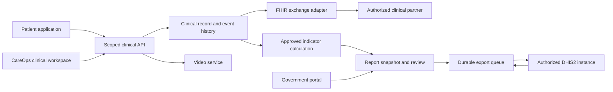

# DoctaRx production and PHC implementation plan

Revised 14 October 2026. Build the main patient/provider platform and CareOps together on a shared clinical foundation: DoctaRx for patients and DoctaRx CareOps for facility teams and authorized government users. CareOps is a provisional name for an independently accessible PHC application inspired by the useful workflows documented in Solo. Complete the PHC care/reporting cycle alongside the main patient/provider journey using the same dependable services. The later user instruction to complete the main platform supersedes PHC-first sequencing.

The user confirmed the design direction: readable text, a clean clinical interface, simpler navigation, and restrained styling inspired by Teladoc. This is the implementation contract. Consult the current scope and release-readiness ledgers for actual code/test evidence; the plan itself does not certify completion or activate external services.

The baseline is [Jonahbaka/zuma-teledoc at d7034d7](https://github.com/Jonahbaka/zuma-teledoc/tree/d7034d7e07ad914fcd2c406c41da5b853ce16b72), also verified as the remote HEAD on October 13, 2026. Revalidate the selected branch and its instructions before implementation. Prior inspection established some consumer interface behavior and historical Solo workflows; it did not recover Teladoc's backend or validate DoctaRx's deployed production environment.

## 1 Product and architecture decisions

The user's latest implementation requirements also cover the public homepage and every administrative surface. Revamp the hero, navigation, service choices and complete footer with premium DoctaRx styling inspired by Teladoc, while keeping DoctaRx's own identity and readable sans-serif typography. Use appropriate generated care imagery; the requested “GPT Images 2.5” model name must not be claimed unless the connected generator actually exposes it. Conceptual marketing imagery is distinct from patient records and must never fabricate clinicians' credentials, testimonials, partner logos, medical data or product evidence.

Default nearby care and pharmacy discovery to the person's device location after browser permission. Keep location optional: denied or unavailable GPS requires an explicit area choice, not invented coordinates or a silent city default. Let the person select Home, Work or another area without storing a personal street address; choosing an area clears GPS, and later device responses cannot overwrite it. Persist a manual choice for the session and selected market, keep precise GPS out of analytics and insurer/payment metadata, cancel stale searches, and sort actual device results by real distance. Manual areas use supported registry filters and do not claim a calculated distance. Show verified empty results separately from directory outages and never infer pharmacy opening hours, stock, insurance participation or prices.

Video must meet the usability expectations of Google Meet: understandable preflight, microphone/camera/device control, waiting/admission, participant tiles, remote audio, screen sharing, leave/end distinction and reconnection with preserved clinical context. A polished preflight or passing SDK contract is insufficient evidence of transport quality; retain the real multi-device/SFU/TURN acceptance gate.

Seamlessly overhaul the main admin portal alongside CareOps and both market portals. Use professional account, credentialing, insurance, finance, reporting and communications navigation; actual section-specific records/counts; readable desktop/mobile layouts; guarded real mutations; reasons and audit where required; truthful retry/cancellation and missing data. Verification changes must update account approval and profile atomically. Manual subscription payments need recorded evidence, stable duplicate-safe commands and current staff authority. Unconnected OCR, eligibility, medication pricing, prior authorization, email transport or subscription checkout must not generate success or paid access.

**Keep one repository and shared clinical services initially.** Preserve Next.js, React, Express, PostgreSQL, existing security middleware, and the working Nigeria modules. Use explicit product, market, institution, programme, and facility configuration. Avoid a second copied backend and a premature migration to microservices.

**Make CareOps standalone for its users.** Give it a dedicated entry point, role-aware navigation, identity configuration, release profile, institution branding, and an institution-approved hostname when available. Initially it can share deployment infrastructure and versioned modules. An institution requiring separate hosting can receive an isolated deployment and database configuration from the same codebase after operational isolation is proven. A hostname is not an authorization boundary; every API and query must enforce scope.

**Give government users a managed back-office portal.** Their sign-in should open approved reporting, review, audit, and programme functions. Clinical access belongs to separately assigned clinical roles. Routine government accounts do not need direct database access or unrestricted platform-administrator privileges.

**Keep clinical exchange and public-health reporting distinct.** EMR data supports care; FHIR supports authorized clinical exchange; DHIS2 receives institution-approved reporting data. Do not turn a FHIR patient export into a government aggregate report, or expose the EMR because an official can approve reports.

**Add a shared funding and billing foundation.** Support self-pay, contracted insurance/HMO benefits, and institutional sponsorship as explicit funding arrangements. Partner insurance adapters and payment gateways use separate permissions, contracts, and evidence. Build these boundaries during Phases 0–2, then activate each partner after its own acceptance gate. Sections 14 and 15 cover the user's subsequent insurance and Nigeria-payment requests.

The government portal also exposes approved aggregate views and scoped audit summaries. The diagram's government path does not confer clinical-record access.

## 2 What to keep, add, simplify, and defer

| Decision | Features | Reason and scope |
| --- | --- | --- |
| Reinforce now | Encounters, consent, allergy/medication history, signed notes, amendments, messaging, prescriptions, referrals | These are the care foundation. Connect them to the same patient, encounter, market, programme, and facility context. |
| Reinforce now | PHC enrollment, queue claiming, conference roles, follow-up, government assignments, approved data imports | Existing Nigeria code is a stronger starting point than building a generic admin dashboard again. |
| Add now | CareOps shell and clinician workspace | A nurse or specialist should complete work without navigating marketing, subscription, pharmacy-marketplace, or agent-operation screens. |
| Add now | Government reporting workspace and delivery status | Give officials usable sign-in, scoped reports, review/return/approval, and evidence of DHIS2 acceptance. |
| Add now | Insurance/HMO partner registry, funding allocation, and payment adapter contracts | Prepare for multiple partners without treating pending onboarding as a live agreement or imposing US billing conventions on Nigeria. |
| Add now | History-completion gate, visit timeline, reconnect guidance, explicit unfinished tasks | These patterns were useful in the consumer inspection and make the workflow understandable. |
| Add next | Longitudinal care plan and closed-loop referrals | Show responsible people, next actions, due dates, completion, and escalation. |
| Add after core reliability | Asynchronous specialist photo cases | Use a dedicated case lifecycle, secure uploads, specialist assignment, response deadline, and follow-up window. |
| Simplify now | Mandatory AI analysis during booking | Make assistance optional. Care must remain available if the AI provider is unavailable. Use governed emergency escalation rules independently of generative output. |
| Hide from pilot | Decorative avatars, holographic styling, heavy gradients, marketing/social automation, sprawling command-center widgets | Replace them with a calm clinical interface. Preserve unrelated consumer/business functionality outside the pilot. |
| Remove or disable until connected | Buttons and notifications that claim prescriptions were sent, coverage verified, or reports synced without evidence | Never present a local status change or successful HTTP response as completed external work. |
| Consolidate gradually | Parallel US/NG booking paths, competing prescription lifecycles, separate video implementations | Introduce explicit adapters and migration contracts. Keep historical records and market rules intact. |
| Exclude from pilot care flow | Consumer subscription upselling and wallet mechanics | Configure institutional entitlement only after the sponsor/funding arrangement is confirmed. Do not make all public consumer care free. |
| Defer | Camera-derived vitals, fall-risk AI, autonomous diagnosis/prescribing, large device fleet management | These need dedicated clinical, device, vendor, and operational evidence beyond this pilot. |
| Defer | Full PACS deployment, every FHIR resource, every PHC programme, native mobile clients | Start with verified web workflows and the exchange/reporting subset the actual pilot requires. |

Hiding features is a product configuration change. Consolidating a workflow requires migration, regression checks, and a rollback plan; it does not mean deleting patient records or unsigned work.

## 3 Patient and clinical experience

### Patient application

Use a concise primary navigation: Home, Get care, Visits, Messages, Health records, and Account. Place pharmacy preferences and coverage inside appropriate account/health sections. Service cards show modality, eligibility, expected availability, and the next action. Availability must come from real scheduling/capacity data.

Onboarding covers identity, guardian/dependent relationships when relevant, contact details, medications, allergies, health history, consent, and programme/coverage eligibility. Unanswered medical fields remain Unknown or Not reviewed. A blank allergy field must never become None automatically.

The patient journey is service selection, required intake, a clear appointment or queue request, confirmation, readiness checks, waiting, consultation, released visit summary, accurate prescription/referral status, and follow-up. Provide an emergency notice and a defined escalation path without implying that booking itself is emergency care. Separate clinical eligibility from funding/payment eligibility.

### CareOps clinical application

Use Today, Patient registry, Encounters, Referrals and follow-up, and Reports as the main clinical navigation. Programme and facility context must be visible and persistent. Keep a patient-identification banner visible during a clinical encounter, including meaningful identity uncertainty and guardian information.

The main workflow is:

1. A nurse enrolls or finds the patient, reviews consent and history, records observations with units/time/source, and opens the encounter.
2. The patient enters the appropriate service queue. The server performs atomic assignment; two clinicians cannot claim the same active item.
3. The specialist reviews the intake and joins with the patient and assisting nurse. The same encounter remains open if media temporarily disconnects.
4. The clinician reviews and signs the note, authorizes prescriptions/referrals within their permissions, and assigns follow-up.
5. Pharmacy/referral acknowledgement and task completion return to the encounter. Reporting consumes eligible clinical events according to approved definitions.

Use a readable encounter workspace with video, patient summary, observations, note drafting, medication/allergy review, and next actions. On small screens, use clear tabs or a drawer instead of shrinking all panels. A call ending does not automatically sign the note or complete every follow-up task.

### Visual design contract

- All visible interface text, including secondary information and inputs: at least 16 px. These are product targets, not claims about a WCAG minimum font size.
- Use 48 px touch controls, clear labels, visible focus, keyboard navigation, and usable layouts at 200% zoom.
- Use the existing blue/cyan DoctaRx wordmark, navy, white and blue actions throughout all portals; remove green regional/company styling. Use appropriate care imagery and premium spacing at the quality expected of a leading US healthcare product, preserving market-specific clinical rules. Use professional navigation such as Insurance management. Use a restrained DoctaRx palette, consistent spacing, plain icons with labels, and status text alongside color. Avoid decorative animation in the care flow.
- Every view has loading, empty, partial, error, and retry states. Distinguish No records from Unable to load records.
- Table density is adjustable. Keep important patient, medication, consent, and report values readable at all supported sizes.
- Forms explain errors beside the field, preserve unfinished work, and state whether it is saved locally or confirmed by the server.

Target [WCAG 2.2 AA](https://www.w3.org/WAI/WCAG22/quickref/) with automated checks and manual keyboard, zoom, focus, and screen-reader verification. Adopt Teladoc's useful navigation and progression patterns while using DoctaRx's own branding and clinical requirements.

## 4 Video calling to production standard

Use one media-service interface and prefer the existing LiveKit path for production multi-party care. Retain peer-to-peer calling only where it is deliberately supported and proven. Move callers to the chosen implementation without breaking appointment links or participant permissions. LiveKit hosting may be managed or institution-hosted; choose after confirming data handling, operating ownership, network access, and cost.

Implement pre-call checks, camera/microphone selection, a waiting room, admission, nurse/specialist/patient roles, mute/video state, screen sharing where appropriate, participant removal, audio-only fallback, network-quality guidance, reconnection, and a safe return to the encounter. Captions require visible status and tested browser support. Recording and ambient transcription are separate capabilities with explicit consent, access, retention, and activation rules; leave them off for the initial pilot unless approved.

Issue tokens only after checking current appointment/room membership, programme/facility scope, active assignment, and admission status. Derive identity and grants on the server. Use opaque room/participant identifiers, keep secrets server-side, and prevent client metadata from becoming a clinical-role authority. Review the existing four-hour token default against the intended session design.

[LiveKit documents](https://docs.livekit.io/frontends/reference/tokens-grants/) that token expiration does not terminate an already connected participant, and revocation behavior differs by hosting mode. Test removal, privilege changes, expired/reused tokens, and reconnects against the chosen deployment. Shorter token lifetime alone is not an immediate revocation control. Use supported revocation/admission mechanisms and resolve any remaining rejoin window before activation.

Verify signed server events before applying them, tolerate duplicates and reordered events, and reconcile backend room state. Follow the [official webhook interface](https://docs.livekit.io/intro/basics/rooms-participants-tracks/webhooks-events/). Use the supported server SDK or prove equivalent token/event handling with contract tests. Protect patient data in telemetry.

The media gate requires real three-person calls on an Android phone, iPhone/iPad, and desktop; restricted networks requiring TURN; mobile Wi-Fi/data handover; weak bandwidth; packet loss; camera denial; and temporary disconnection. Validate TLS, TURN/TLS, firewall rules, recovery, load, and monitoring using the [deployment guidance](https://docs.livekit.io/transport/self-hosting/).

## 5 EMR integrity and continuity

Define the clinical record as the authoritative care history. Establish explicit ownership for each patient, appointment, encounter, observation, note, prescription, and referral across US/NG and PHC programme contexts. Any cross-system identity mapping must be validated and versioned; do not match patients by name alone.

Use typed fields for problems, allergy status, current medications, vital observations, assessments, care plans, and follow-up. Preserve source, author, facility, event time, entry time, unit, and verification status. Use Unknown, Not asked, None reported, and Verified none where appropriate instead of a single empty/default value.

Require optimistic record versions for updates, idempotent commands, and transactions for linked changes. Enforce unique active ownership for queue/encounter transitions. Sign notes against a stable content version using the authenticated author and audit trail. Signed content is immutable; corrections use linked amendments. Separate clinical completion, note signing, patient release, and report eligibility.

Attachments need bounded formats/sizes, malware checks, protected storage, expiring access, encounter linkage, and functioning view/download controls. Patient-visible content follows an explicit release policy; draft clinician notes should not appear by accident. Care-team messaging needs encounter/relationship authorization, delivery state, urgency ownership, and escalation expectations.

Document access, exports, signing, corrections, consent changes, and disclosures with an auditable event trail. Support encrypted backups, restore drills, retention, authorized correction, and legal-hold workflows according to the institution's approved policies. Encryption and audit code alone do not establish legal or clinical certification.

## 6 FHIR interoperability

Keep FHIR R4 4.0.1 as the initial interoperability target unless a named partner requires another version. Start with Patient, Practitioner/PractitionerRole, Organization/Location, Encounter, Observation, Condition, AllergyIntolerance, MedicationRequest, DocumentReference, ServiceRequest, and the consent/provenance/audit representations the exchange contract requires. Do not implement resources that have no agreed use case.

Declare the implemented subset in a truthful [CapabilityStatement](https://hl7.org/fhir/R4/capabilitystatement.html). Use target-approved profiles, code systems, units, identifier rules, and search behavior. Do not apply US Core profiles indiscriminately to Nigeria data. Correct inappropriate profile declarations and inconsistent references in the existing mapper/Bundle paths.

Validate structure, terminology, references, and required partner profiles at controlled boundaries. Preserve rejected inbound records in protected quarantine with actionable errors; do not silently discard clinical content. Validation alone does not prove interoperability. The [FHIR validation guidance](https://hl7.org/fhir/R4/validation.html) calls for appropriate validation and recovery choices.

For actual partner access, implement the agreed OAuth/SMART or service-authentication flow, scoped permissions, audience/issuer checks, key rotation, and consent requirements. Isolate outbound endpoints and credentials behind approved partner configuration. FHIR is an exchange contract, not an authorization system by itself.

Build contract tests and an authorized sandbox round trip for the agreed resources. Prove patient matching, update/version conflicts, consent denial, clinician/facility scope, retries, error handling, and reconciliation. A successful JSON export is not proof of an Epic or Oracle Health connection. Keep the EMR authoritative until a specific ownership contract says otherwise.

## 7 Government sign-in and permissions

Reuse the existing government assignment, MFA, jurisdiction, programme, facility, expiry, audit, and maker-checker machinery. Test it against real PostgreSQL and the browser. Revoking an assignment must invalidate relevant access caches and block subsequent protected requests; a JWT title alone is insufficient.

| Role | Default access | Workflow authority |
| --- | --- | --- |
| Nurse and assigned clinician | Clinical records within approved facility/programme scope | Intake, observations, consultation, documentation and clinical actions according to role |
| Facility data officer | Assigned facility aggregate/staging data | Prepare, validate, submit, and correct returned reports |
| Area Council/HMIS reviewer | Assigned jurisdiction and descendants, approved programmes | Review, return, and annotate; no automatic final approval |
| Approver/data steward | Assigned reporting scope | Approve another person's submission; cannot approve their own work |
| Programme administrator | Assigned programme configuration and aggregates | Manage allowed configuration; no automatic global clinical or infrastructure privilege |
| Executive viewer | Approved aggregates with freshness/quality context | Read-only; exports require explicit assignment |
| Auditor | Approved scope and protected audit summaries | Inspect evidence; no clinical editing |
| Platform technical administrator | Separately controlled technical scope | Exceptional operations with expiry, step-up controls, and access review |

The government workspace should include Overview, Facility reports, Review queue, Data quality, DHIS2 delivery, and Audit/Access where authorized. Support secure invitations, role acceptance, MFA setup, account recovery, institutional SSO when available, and offboarding. No self-selected government privilege or automatic elevation based on email domain.

Use approved aggregate read models for executive views. Apply the institution's small-cell disclosure policy where required without silently changing official report values. Named clinical users may receive patient-level access for approved care purposes through separate assignments. Confirm these policies with the Board before provisioning real accounts.

## 8 DHIS2 delivery as a complete workflow

Start with aggregate reporting. Tracker/event-level integration is a separate approved scope. Obtain the actual instance version, dataset, organisation units, data elements, category/attribute combinations, period rules, credentials, and approved indicator definitions from the Board; do not invent identifiers or rely on examples from documentation.

The initial inspection found that `publicHealthProgrammeService.syncDhis2` posted directly and marked a report synced from `response.ok`. The implementation now connects approved report snapshots to retained delivery jobs and remote-value reconciliation; HTTP success alone cannot mark a report synced. Autonomous retry/backoff, asynchronous import-task polling and an operator correction/resolution workflow remain required engineering before live activation. The scope ledger records the current implementation and acceptance evidence.

The required sequence is clinical/source events, versioned indicator calculation, immutable report snapshot, validation, submitter review, independent approval, authorized export queue, remote import evaluation, reconciliation, and a retained delivery receipt. Corrections create a new version and approval record rather than overwriting the evidence for a prior export.

Implement a PostgreSQL outbox with payload and mapping versions, approval binding, destination identity, attempts, leases, retry scheduling, remote job ID, result counts, and final status. Reuse a queue library only as the execution mechanism; the database remains the durable evidence store. Apply request timeouts, controlled retries, permanent-error handling, and a manual reconciliation queue for ambiguous outcomes.

Use canonical absolute values and verified remote update semantics rather than sending increments. Include dataset, organisation unit, period, category/attribute combinations, mapping version, and report revision in relevant identity/hash rules. Distinguish a transport retry from an authorized corrected report. Promise reconciliation and duplicate safety, not an unproven exactly-once distributed delivery guarantee.

The [DHIS2 API](https://docs.dhis2.org/en/full/develop/dhis-core-version-master/developer-manual.html) returns import summaries and supports asynchronous imports. The adapter must match the actual deployed version, parse per-value/import errors, poll remote jobs when applicable, and confirm the intended values before reporting success. HTTP 200 or 202 alone is insufficient.

Only approved fields enter the wire payload. Preserve true zero versus unknown/not-collected values, units/value types, disaggregations, source definition, source time, and report period. Use an allowlisted aggregate schema, not just a patient-name regex. Keep UI-only labels, patient identifiers, clinical narratives, and secrets out of the payload and logs.

Show Draft, Needs correction, Awaiting review, Approved, Queued, Submitted, Importing, Confirmed, Partially rejected, Failed, and Awaiting reconciliation as distinct reporting states. Keep clinical, report approval, and delivery state machines separate. Retain existing live-sync gates until institutional approval, mappings, sandbox evidence, credentials, and reconciliation sign-off are recorded.

## 9 Offline work and operational reliability

Keep offline capability bounded to supported intake drafts and observations on approved devices. Distinguish local persistence, pending upload, confirmed server commit, and conflict. Sign queued operations, preserve original timestamps/units, use command IDs, and reconcile stale record versions. Do not claim that live video works offline.

Require coordinated server confirmation for queue claiming, final clinical signing, external prescriptions, report approval, and export. Do not allow a disconnected device to award itself an assignment or report an external action as complete. Offline PHI storage requires a reviewed device/retention policy, protected local data, account isolation, and logout cleanup. Service workers must not cache authenticated patient responses indiscriminately.

Use isolated development, staging, pilot, and production environments. Use existing provisioned demo accounts and their actual records for browser verification. Do not create fabricated presentation records, fallback charts/vitals, or fake receipts/success when data is empty or APIs fail. Keep isolated automated test fixtures separate from institutional records. Add health/readiness checks, database and worker monitoring, migration verification, backup restoration, dependency checks, secret rotation, restricted admin access, safe log redaction, and an incident runbook. Report provider outages explicitly and preserve care documentation through them.

## 10 Delivery phases and release gates

| Phase | Main deliverable | Exit gate |
| --- | --- | --- |
| 0 Correctness baseline | Trace active paths, reconcile docs with code, fix or hide false success, enforce market/object scope, identify canonical record ownership | Regression evidence for booking races, history/consent, scope denial, prescription status, missing values, and migrations; no invented external success |
| 1 Product shells and design system | Readable patient and CareOps shells, component tokens, role navigation, responsive forms/tables, clear failure states | Representative desktop/mobile/tablet screens pass keyboard/zoom/accessibility review and user tasks; hidden features remain protected by API permissions |
| 2 PHC care slice | Enrollment, reviewed history/consent, observations, atomic queue claim, three-person call, signed note/amendment, prescription/referral/follow-up | PostgreSQL integrity proof and browser end-to-end proof using existing provisioned demo accounts, real SFU/TURN/device evidence, no duplicate/stale/cross-scope actions |
| 3 Government and DHIS2 slice | Scoped government sign-in, report snapshots, review/approval, persistent outbox, import-status handling and reconciliation | Role matrix and maker-checker tests, approved sandbox import, retry/crash/rejection/correction tests, zero unauthorized identifiers in exports |
| 4 Clinical exchange and pilot operations | Agreed FHIR subset, partner sandbox, monitoring, restore/rollback, training, pilot support | Conformance and partner contract tests plus operational ownership and institutional acceptance; activate only approved capabilities |
| 5 Main-platform completion (concurrent with phases 1–4) | Apply shared reliability and UI improvements to patient booking, records, messages, pharmacy/referral status and care plans | Complete patient lifecycle tests across correct market/benefit paths and demonstrated graceful provider failures |
| 6 Optional expansion | Photo cases, ambient documentation, approved devices, additional PHC programmes | Separate product/clinical/data/provider approval and evidence for each capability; no automatic broad activation |

Video, EMR integrity, access control, and the reporting contract are mandatory for their respective pilot workflows. A live FHIR connection is mandatory if the pilot contract depends on a named EHR partner; otherwise ship the validated adapter disabled and state that dependency accurately.

## 11 Proposed acceptance targets

These are engineering targets to validate against the pilot's devices, connectivity, volume, and operating budget—not measured results or contractual promises.

- Zero observed cross-jurisdiction, cross-facility, cross-market, or unauthorized clinical reads in the complete negative-test matrix.
- Exactly one winning claim when concurrent clinicians request the same waiting encounter; repeated commands do not create duplicate notes, orders, or export jobs.
- Signed notes remain unchanged by concurrent requests, retries, offline updates, and later amendments.
- At least 99% successful authorized joins and a 95th-percentile first-media time under 15 seconds on the agreed reference network; measure weak-network performance separately.
- A three-person consultation recovers from the agreed disconnect scenarios while preserving encounter context; removed participants and changed permissions behave as the chosen hosting model guarantees.
- Eligible approved sandbox reports reconcile to the intended DHIS2 values, including partial errors, ambiguous timeouts, corrections, and worker restart.
- Pilot API availability target 99.5% per month; dashboard/queue API p95 under one second at the agreed pilot load, measured separately from media and external APIs.
- Proposed backup recovery objectives: at most 15 minutes of recoverable database loss and restoration within four hours, subject to hosting capability and a witnessed restore drill.
- Critical care, consent, and report approval tasks remain usable with keyboard input, 200% zoom, and the selected tablet/mobile screen sizes.

A release gate fails when a critical capability has only mock, source-contract, or happy-path evidence. Preserve those tests, but add database, browser, real media, sandbox, and recovery evidence appropriate to the claim.

## 12 Inputs and ownership before activation

The Board/institution must provide pilot facilities and jurisdictions, approved clinical and reporting roles, authorised indicator definitions, DHIS2 metadata/version/sandbox, data-sharing and retention decisions, hosting requirements, and acceptance participants. Clinical leadership owns treatment and escalation protocols; the implementation team does not invent them from AI output.

Assign owners for clinical workflow, HMIS/indicator governance, government access, media/hosting operations, security/data handling, partner interoperability, and user acceptance. A small team may combine positions, but every release gate needs a named owner.

Resolve whether the government wants aggregate reporting only, specifically assigned clinical access, Tracker data, or additional historical-data imports. The recommended initial assumption is aggregate reporting plus clinical access for named care staff—not unrestricted patient access for every government account.

Before rollout, prepare the approved configuration, screenshots of completed tasks, test and sandbox receipts, migration/rollback plan, restore evidence, user training, and support escalation. Institutional approval and any required clinical/legal assessment are external activation prerequisites; do not manufacture those statuses in code or documentation.

## 13 First implementation assignment

Start with Phase 0 and one CareOps care/reporting journey. Harden the shared booking route and its US/NG routing; replace false external-success behavior; define patient-history and consent requirements; and bind every action to current clinical/government scope. Then deliver the clean CareOps shell and the nurse-to-specialist-to-signed-note slice before broad visual redesign or optional AI work.

The next useful outcome is a pilot that a nurse, remote specialist, facility data officer, reviewer, and approver can each operate safely, with one encounter traceable to an approved and remotely confirmed report. That outcome should govern the backlog and release claims.

## 14 Insurance and HMO partnerships

The email supplied by the user confirms that Hygeia HMO has referred the inquiry to its onboarding team for review. It does not establish an executed provider contract, accepted tariffs, API access, covered telemedicine services, or a payment commitment. Record the partner as Onboarding review; leave live eligibility, authorization, and claim submission inactive until confirmed. Prepare a reusable integration framework now so additional HMO partnerships do not require rewriting clinical care.

### Partner and funding model

Create an institution-scoped partner registry with onboarding stage, contract references and effective dates, provider/facility identifiers, supported markets, currencies, services, plans, tariffs, authorization rules, submission channel, capabilities, and operational contacts. Suggested onboarding stages are Prospect, Review, Contracted, Sandbox validation, Live, Suspended, and Ended. Keep secrets in managed configuration, separate from ordinary partner records.

Associate a patient with a partner-issued member identity and coverage period, with dependent relationships when supplied. Store the verification source, reference, time, service/date context, and expiry. A saved insurance card establishes supplied membership details; it does not establish current benefits or authorization.

Each encounter has a versioned funding allocation: institutional sponsor, insurer responsibility, patient responsibility, and any approved adjustment. Apply effective-dated tariffs and currency using integer minor units. Keep clinical necessity and funding approval distinct. Prevent charging the patient the same amount subsequently collected from the insurer without an adjustment/refund workflow. Apply approved emergency and sponsored-care rules; the engineering team must not invent them.

### Adapter contracts and workflows

Define capability-driven methods for eligibility/benefits checks, authorization requests and status, claim submission/status, supporting-document exchange, remittance import, and reconciliation. A partner can implement only the capabilities it actually supports. Include API, approved file/batch, and staff-assisted portal/manual channels. Staff-assisted submission requires an accountable user and retained external receipt; it must never masquerade as an automated API response.

Use explicit lifecycles:

- Eligibility: Unchecked, Pending, Verified, Inactive, Unknown, Error, and Expired. Preserve service-specific limitations and benefit exclusions.
- Authorization: Draft, Requested, Pending, Needs information, Approved, Denied, Expired, and Cancelled. Bind approval to the patient, service, facility, date range, permitted amount/units, and payer reference.
- Claims: Draft, Validated, Submitted, Acknowledged, Adjudicated, Partially paid, Paid, Denied, Corrected, and Voided as appropriate to partner semantics. Transmission acceptance is distinct from adjudication and settlement.

Generate claims from authorized, traceable encounter services and signed documentation. Use the partner's agreed coding system and tariff rules, not automatic CPT/USD defaults. Preserve originals and revision relationships during corrections and appeals. Durable submission jobs need idempotency references, bounded retries, remote acknowledgement, ambiguous-outcome reconciliation, and protection against duplicate claims.

Match remittances to claims and line items, retain adjustment/denial codes and settlement references, and reconcile actual bank settlement where required. A staff member marking a claim paid without payment evidence should remain a separately audited manual action with appropriate authority.

FHIR R4 offers [CoverageEligibilityRequest](https://hl7.org/fhir/R4/coverageeligibilityrequest.html), [Claim](https://hl7.org/fhir/R4/claim.html), and [ClaimResponse](https://hl7.org/fhir/R4/claimresponse.html) for eligibility and claim/authorization exchanges. Use them only when the partner agrees to FHIR and its profiles. Do not assume Hygeia offers FHIR, an API, or US clearinghouse protocols.

### Existing code to reinforce

`server/services/eligibilityService.js` currently returns simulated ACTIVE coverage even when an API key exists. `server/services/claimsService.js` has simulated Change Healthcare and Waystar acceptance methods. These must be disabled in the product until an actual adapter confirms the outcome; isolated contract tests may use fixtures, but signed-in demo accounts must not receive invented coverage or claim acceptance.

`server/routes/claims.js` contains broad provider listing and insufficient provider ownership checks around individual claims and mutations. Reinforce patient relationship, market, institution/facility, provider, and payer scope for every list/read/write, including exports and attachments. Reuse `insuranceWalletService` and existing claims screens only after tracing their data ownership and real integration behavior. A wallet name does not justify holding patient funds.

Add a focused Billing and insurance workspace for authorized care administrators. Give patients a readable benefit/authorization status, estimated responsibility with its source, receipts, and outstanding amounts. An insurer portal is optional: if requested, payer users see only their contracted members/claims and required supporting documents. They receive no default access to the patient registry, unrestricted longitudinal EMR, government reports, or another payer's records.

### Meeting preparation and activation gate

Ask the onboarding team to confirm:

1. Contracting entity, provider and facility registration requirements, and approved service locations.
2. Whether virtual consultations, nurse-assisted PHC care, specialists, referrals, and prescriptions are covered, and which plans apply.
3. Agreed tariffs, patient contributions, funding/payment arrangement, authorization rules, and service limits.
4. Membership/eligibility channel and freshness requirements; API documentation and sandbox if available, otherwise portal/file procedures.
5. Claim format, coding, attachments, submission deadlines, acknowledgement/status channel, correction/appeal process, and remittance format.
6. Data-sharing, access, retention, security requirements, reconciliation ownership, and operational escalation contacts.

During Phases 0–2 implement truthful status, scoping, registry, funding records, and adapter contracts. Add partner-specific behavior after documentation is received. If the pilot is insurer-funded, verified eligibility/authorization and accepted claims are pilot gates; if institution-funded, keep insurance disabled without blocking supported sponsored care.

Before live activation, prove authorized eligibility, approval/denial, expired coverage, changed tariff, duplicate submission, partial remittance, correction, refund/adjustment, outage/manual fallback, and cross-payer access denial using the partner's sandbox or formally accepted test process. Existing claim simulations are not this evidence.

## 15 Nigeria payments: current recommendation and implementation scope

**Use Paystack first for Nigeria; retain Stripe for an eligible supported-country merchant entity where appropriate.** Stripe's current [global availability page](https://stripe.com/global) lists Nigeria under its extended network and links to Paystack. This supports choosing Paystack for a Nigerian merchant; it does not establish direct Nigerian access to the Stripe Payments API, Stripe Billing, or Stripe Connect. An existing eligible foreign entity/account can be assessed separately for its actual merchant and settlement arrangement. Do not create a foreign entity just to finish the pilot checkout.

| Gateway | Current public evidence checked October 13, 2026 | Recommendation |
| --- | --- | --- |
| Paystack | Nigeria checkout with supported card/bank-transfer/USSD channels; standard local fee 1.5% + ₦100, the ₦100 waived below ₦2,500, capped at ₦2,000 | Primary Nigerian collection adapter; start with hosted checkout |
| Flutterwave | Nigeria local collections advertised at 2%, international at 4.8%; published transaction fees subject to VAT | Optional second provider after its independent test/activation gate |
| Stripe | Nigeria listed as extended network through Paystack | Keep existing supported-market integration; do not treat it as a drop-in Nigeria gateway |

Sources: [Paystack pricing](https://paystack.com/pricing), [Paystack channels](https://paystack.com/docs/payments/payment-channels/), and [Flutterwave Nigeria pricing](https://flutterwave.com/ng/pricing). Confirm merchant approval, enabled channels, negotiated fees/taxes, settlement currency, and bank account during onboarding. Prices are a checked planning snapshot, not hardcoded business rules.

The repository already contains `ng/services/payments/paystackService.js`, `flutterwaveService.js`, `paymentOrchestrator.js`, and `ng/routes/webhooks.js`. The current Nigerian orchestrator is mainly pharmacy-order oriented. Trace consultation, invoice, and billing callers before reuse; do not assume creating an order payment also funds a PHC encounter.

### First payment milestone

Implement one-time NGN consultation invoices and the approved patient copayment/self-pay flow, with institutional sponsorship supported separately. Use a server-calculated invoice amount, immutable price/funding snapshot, currency, authenticated owner, and opaque invoice reference. Store values in integer kobo end to end. Initialize hosted checkout on the server; do not collect card numbers/CVV in DoctaRx forms or logs.

The callback screen shows Verifying until server confirmation. Validate the transaction reference, actual success status, currency, amount, correct invoice/merchant/environment, and current invoice state before posting money or granting a payment-based entitlement. Follow [Paystack payment verification](https://paystack.com/docs/payments/verify-payments/). A browser redirect is not payment proof.

Use a durable webhook inbox, transactional processing, deduplication, and recoverable job status. [Paystack's webhook contract](https://paystack.com/docs/payments/webhooks/) uses HMAC-SHA512 with the merchant secret key. Capture the original request bytes, validate the signature with that key, use a constant-time comparison, persist verified events, then acknowledge and process safely. Review the existing separate `PAYSTACK_WEBHOOK_SECRET` configuration and JSON reserialization against this contract; do not assume an arbitrary separate secret is valid.

Bind each attempt to one provider and one invoice. The existing orchestrator automatically switches to Flutterwave after primary errors and creates a new reference. Replace this broad fallback with explicit attempt states and verification: an ambiguous Paystack timeout must not trigger another collectible payment until the original outcome is resolved. If a second checkout is eventually offered, reconcile late payments and excess collection across all attempts. Do not switch gateways midway through an existing transaction.

Maintain an auditable ledger and explicit invoice/payment/refund/settlement states. Include cancelled checkout, delayed bank transfer, duplicate/reordered events, under/overpayment, callback without webhook, webhook without callback, signature failure, test/live mismatch, refunds, disputes, provider outage, and crash recovery tests. Require sandbox evidence plus merchant approval before live activation.

Keep patient payments, HMO receivables, and sponsor receivables distinct. Paying a copayment does not prove insurer approval or settlement. Delay recurring charges, stored-card charging, split payouts, automatic provider transfers, and wallet custody until the business arrangement and gateway capabilities are confirmed; existing pharmacy split-payment code is not proof that consultation payouts are ready.

Build payment contracts and truthful status in Phase 0, the hosted checkout/receipt/refund slice alongside Phase 2 or Phase 5 depending on the pilot funding model, and live activation only after the gateway gate. Sponsored pilots must not accidentally receive a self-pay checkout. A payment success must not mark the clinical encounter completed.
## Current scope control

The later user instructions override the original sequencing and visual defaults. Main DoctaRx patient/provider delivery is required alongside CareOps; every product surface uses DoctaRx branding, readable 16 px text and 48 px controls. Browser previews use existing demo accounts without creating presentation data. A green regional brand, tiny labels, fake vitals and unverified external success are unacceptable.

The current scope ledger in `docs/DOCTARX_SCOPE_LEDGER.md` records implemented evidence, remaining engineering, external activation, and optional expansion independently. Keep every requirement traceable to an active path, verification and release gate. Update it after each milestone. Earlier documents marking whole portals or security VERIFIED COMPLETE from source/build checks are historical evidence, superseded by the current ledger for this work.

Before calling the scope complete, verify both markets' active patient/provider journeys, CareOps clinical/government roles, pharmacy/admin regressions, real multiparty media, clinical safety/signing/release, partner FHIR and DHIS2 acceptance, insurer capabilities, payment reconciliation and operations. Credentials block external acceptance only; they do not excuse unfinished worker, workflow, deployment, monitoring or UI engineering.

